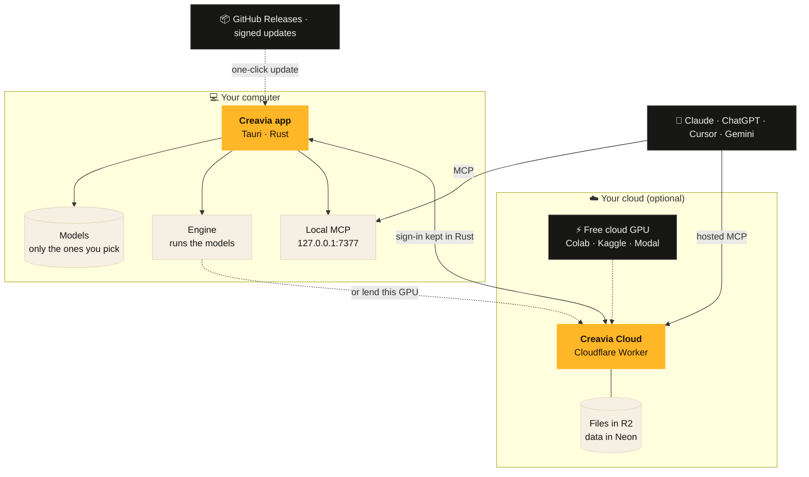

<p align="center"></p>

<p align="center">
  <b>Create, publish and grow.</b><br>
  Voiceovers in your own voice, clean audio, subtitles, images, posts and analytics,<br>
  on your own computer or your own cloud.
</p>

<p align="center">
  <a href="https://github.com/aspershupadhyay/creavia/releases/latest"><b>⬇ Download Creavia</b></a>
  &nbsp;·&nbsp;
  <a href="#-install">Install</a>
  &nbsp;·&nbsp;
  <a href="#-your-studio-online">Host it online</a>
  &nbsp;·&nbsp;
  <a href="#-develop">Develop</a>
</p>

---

## ✦ What it is

Creavia is a small, fast desktop app (Tauri + Rust) with Vee, the little one with the spark, as your guide.

| | |
|---|---|
| 🎙 **Make** | Voiceovers, your own cloned voice, studio clean-up, subtitles, images and video |
| 🧠 **Models, your choice** | Nothing is bundled. Download only the models you want, straight from their makers. No account, no token |
| 🌍 **Your studio online** *(optional)* | Posts, files, publishing to YouTube and Instagram, analytics, on your own Cloudflare account |
| 🔌 **Works with your AI** | An MCP server for Claude, ChatGPT, Cursor and Gemini, on your computer or hosted |
| ✨ **Updates itself** | A card says a new version is ready. One click and it restarts, updated |

## ✦ How it fits together



## ⬇ Install

Download the file for your computer from **[the latest release](https://github.com/aspershupadhyay/creavia/releases/latest)**:

| Your computer | The file to take |
|---|---|
| 🍎 Mac with an Apple chip (M1, M2, M3, M4) | `Creavia_x.y.z_aarch64.dmg` |
| 🍎 Mac with an Intel chip | `Creavia_x.y.z_x64.dmg` |
| 🪟 Windows 10 / 11 | `Creavia_x.y.z_x64-setup.exe` (or the `.msi`) |
| 🐧 Linux (any) | `Creavia_x.y.z_amd64.AppImage` |
| 🐧 Ubuntu, Debian, Mint | `Creavia_x.y.z_amd64.deb` |
| 🐧 Fedora, RHEL, openSUSE | `Creavia-x.y.z-1.x86_64.rpm` |

> [!NOTE]
> **Creavia isn't signed with a paid Apple or Microsoft developer certificate (yet).** It's free and open source, so the
> first time you open it, your computer asks whether you trust it. That's expected: say yes once, as shown below, and it
> never asks again. Updates are still checked: each one is signed with Creavia's own key and verified before it installs.

<details open>
<summary><b>🍎 macOS</b></summary>
<br>

1. Open the `.dmg` and drag **Creavia** into **Applications**.
2. Open **Applications**, **right-click** Creavia → **Open** → **Open**.
3. On macOS 15 (Sequoia) or later, if there's no **Open** button: open **System Settings → Privacy & Security**, scroll
   down, and press **Open Anyway** next to Creavia.

If your Mac says Creavia **“is damaged and can't be opened”**, it isn't. That's the message macOS shows for apps from
outside the App Store without a paid certificate. Open **Terminal** and run this once:

```bash
xattr -dr com.apple.quarantine /Applications/Creavia.app
```

Then open Creavia as usual.

</details>

<details>
<summary><b>🪟 Windows</b></summary>
<br>

1. Run `Creavia_x.y.z_x64-setup.exe`.
2. If a blue box says **“Windows protected your PC”**: press **More info** → **Run anyway**.
3. Follow the setup. Creavia is in the Start menu.

If your browser blocks the download, keep it (in Edge: **⋯ → Keep → Show more → Keep anyway**). Or, in PowerShell:

```powershell
Unblock-File "$env:USERPROFILE\Downloads\Creavia_*_x64-setup.exe"
```

</details>

<details>
<summary><b>🐧 Linux</b></summary>
<br>

**AppImage** (works on any distribution): make it runnable once, then double-click it or run it.

```bash
chmod +x Creavia_*_amd64.AppImage
```

```bash
./Creavia_*_amd64.AppImage
```

If it says something about **FUSE**, install it (Ubuntu 22.04: `libfuse2`; Ubuntu 24.04 and later: `libfuse2t64`):

```bash
sudo apt install libfuse2t64
```

**Ubuntu / Debian / Mint:**

```bash
sudo apt install ./Creavia_*_amd64.deb
```

**Fedora / RHEL / openSUSE:**

```bash
sudo dnf install ./Creavia-*.x86_64.rpm
```

</details>

### Then

Vee walks you through the first minute: what you want to make, a look at your computer, and your first models.
Everything else is in the **Guide** inside the app (step by step, with pictures), before and after you sign in.

| | macOS | Windows | Linux |
|---|:---:|:---:|:---:|
| The app, the studio, the guide | ✅ | ✅ | ✅ |
| Kokoro voices on this computer | ✅ | ✅ (WSL2) | ✅ |
| Big models on this computer (NVIDIA GPU) | — | ✅ (WSL2) | ✅ |
| Updates in one click | ✅ | ✅ | ✅ (deb/rpm ask for your password) |

No NVIDIA GPU? The bigger models can run on a free cloud GPU from your studio online. Apple Silicon support for the big
models is on the way ([docs/PLAN.md](docs/PLAN.md)).

## 🧠 Models are never shipped

Like ComfyUI, Creavia ships no model weights. The **Models** page shows what each model does, its size, whether it fits
your GPU, and its licence. Press **Download**: it comes straight from its maker, with no account or token. Downloads
resume if your connection drops and are checked against the maker's checksum. More in [docs/MODELS.md](docs/MODELS.md).

## ☁️ Your studio online

Optional, and it runs on your own Cloudflare account, so it's yours. You need **Cloudflare Workers Paid ($5 a month)**;
the database (Neon) and file storage (R2) start free. The in-app guide (**Put your studio online**) walks through it step
by step, and even makes your two secret keys.

**One click:**

[](https://deploy.workers.cloudflare.com/?url=https://github.com/aspershupadhyay/creavia/tree/main/cloud)

**Or from a terminal** (signs you in, makes the storage, asks for the database, makes the keys, deploys):

```bash
git clone https://github.com/aspershupadhyay/creavia && cd creavia && npm install
```

```bash
npm run cloud:deploy
```

Then in the app: **Connect** → paste your studio's address → sign in. Details and extras (YouTube, Instagram, cloud GPUs)
are in [docs/DEPLOY.md](docs/DEPLOY.md).

## 🔌 MCP, local or hosted

- **On this computer:** `http://127.0.0.1:7377/mcp`, with a token. The engine's tools, plus every tool of your studio
  when you're connected. The app's **MCP** page has copy-paste settings for Claude Code, Claude Desktop, Cursor, VS Code
  and Gemini CLI.
- **Hosted:** `https://<your studio>/api/mcp`, with OAuth, for claude.ai, ChatGPT and phones.

More in [docs/MCP.md](docs/MCP.md).

## 🛠 Develop

You need Node 22, Rust (stable) and, on Linux, the WebKitGTK libraries
([Tauri's prerequisites](https://v2.tauri.app/start/prerequisites/)).

```bash
npm install
```

```bash
npm run desktop
```

That starts the app with hot reload. The cloud alone: `npm run cloud:dev`. Checks: `npm run check`, and
`desktop/src-tauri/target/debug/creavia --self-check=full`, which tests the Rust side end to end: it downloads Kokoro,
sets up and starts the engine, and voices a line through the MCP.

**Releasing:** bump the version in `desktop/src-tauri/tauri.conf.json` and `Cargo.toml`, then **Actions → Desktop →
Run workflow** with `release` = `v0.2.0`. It builds every installer, publishes the release, and installed apps offer
the update themselves.

The plan and what's next: [docs/PLAN.md](docs/PLAN.md) · Design: [docs/DESIGN.md](docs/DESIGN.md)

<p align="center"><sub>Made with care, and a little spark ✦</sub></p>
